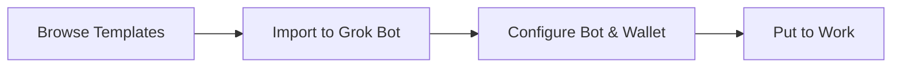

# How It Works

Wayfind makes it easy to put Grok Bot to work with onchain capabilities through a simple four-step process.

## Overview

## Step by Step

### 1. Download Bot Templates
Browse available templates on [wayfind.click](https://wayfind.click/). Each template is purpose-built for a specific use case - tokenized stocks, USDC payments, or Bitcoin finance - with skills and memory included.

### 2. Create Your Agentic Wallet
Import the template into your [Grok Bot](https://x.ai/grok-bot). Your bot will create an encrypted wallet on its dedicated computer. For some templates (like Solana Tokenized Stocks), you'll need a Wayfind API key to access additional data and features.

### 3. Configure & Coordinate
Name your bot based on its role (CFO, HR, Research, Marketing, etc.). Build a bot team where each agent has specialized skills and they coordinate to complete tasks together.

### 4. Put Your Bots to Work
Your bots run 24/7 on their dedicated computers. They can monitor data, prepare transactions, request approvals, and execute onchain actions autonomously based on your instructions and workflows.

## Multi-Agent Coordination

Grok Bot and proactive AI agents can coordinate as teams of specialized bots:

| Role | Typical Responsibilities | Example Use Cases |
|------|---------------------------|-------------------|
| **CFO** | Treasury management, approvals, payments | Review and execute financial transactions |
| **HR** | People operations, tracking, payroll coordination | Manage freelancer payments, generate payslips |
| **Research** | Data gathering, analysis, opportunity discovery | Monitor yields, analyze tokenized stocks, track protocols |
| **Marketing** | Content creation, publishing | Turn research into content, publish updates |
| **Investment Analyst** | Risk analysis, portfolio management | Evaluate tokenized stocks, assess risk, suggest rebalancing |

## Approval Workflows

For security, bots don't execute all actions blindly. They follow approval patterns:
- **Prepare First** - Bots gather data, calculate amounts, and prepare transaction details
- **Request Approval** - They summarize the action and ask for your confirmation
- **Execute on Approval** - Once approved, they sign and send the transaction from the bot's wallet
- **Report Results** - They return transaction hashes and confirm completion

## Next Steps

- [Set up your first bot](../getting-started/grok-bot-setup.md)
- [Explore templates](../templates/README.md)
- [Learn about agent skills and MCP](../for-ai-agents/README.md)
